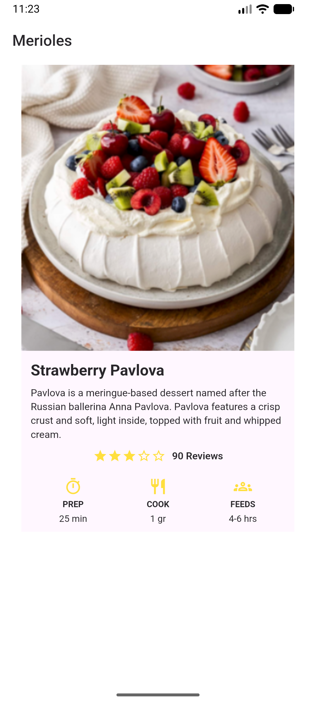

# Strawberry Pavlova Recipe

A Flutter recipe detail screen inspired by the supplied Strawberry Pavlova
reference. It displays the recipe photo, description, three-of-five-star rating,
review count, and preparation, cooking, and serving details.

## Run

```powershell
flutter pub get
flutter run
```

The pavlova image is bundled locally in `assets/strawberry_pavlova.png`.

## Emulator screenshot



## Validate

```powershell
flutter analyze
flutter test
```

## Repository

https://github.com/tao-ako/Pavlova_Merioles
